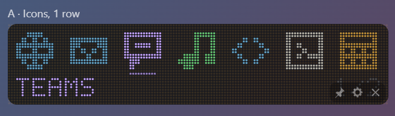
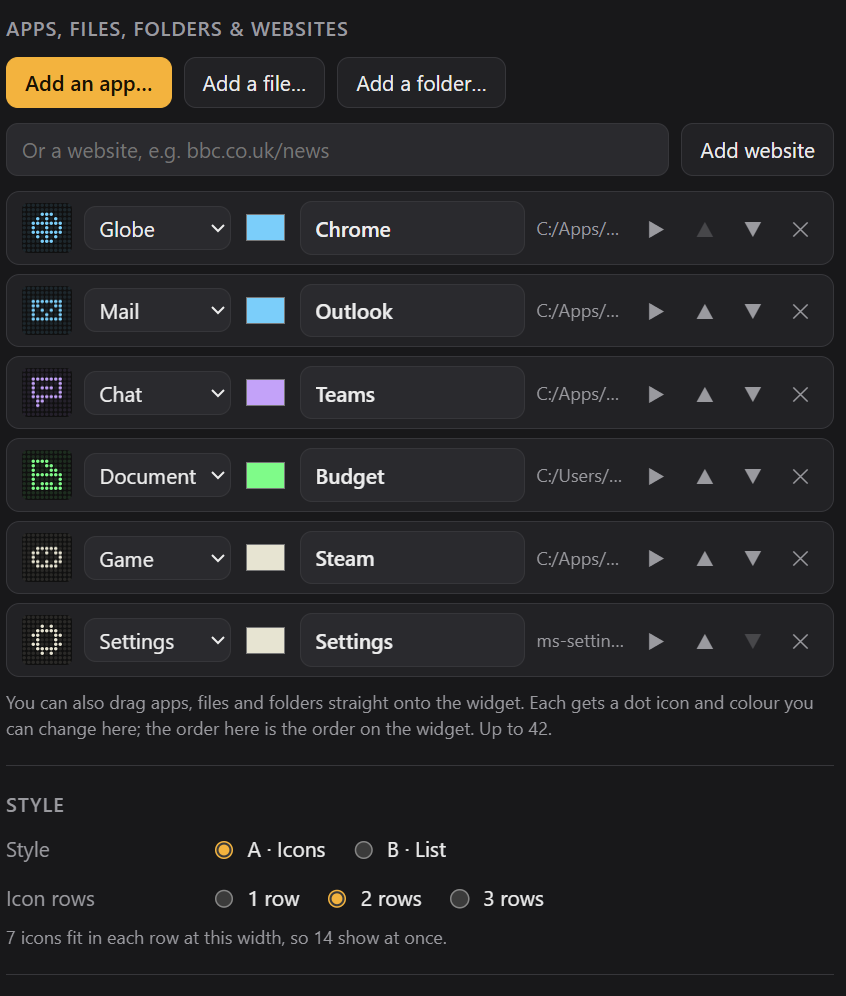

# Dot Launcher

A dot-matrix launcher for Windows and macOS: your favourite apps, files, folders and websites, one click away. It's from the same family as [Dot Clock](https://github.com/slainbya-dotcom/dot-clock) and the other Dot widgets.

## What it does

**Two styles.** Pick one in settings:

| Style | What it looks like |
|---|---|
| A · Icons | 1, 2 or 3 rows of dot-matrix icons. Hover over one to see its name along the bottom, and click to open it |
| B · List | Two columns of a small icon and the name |

If you have more items than fit, scroll the mouse wheel over the widget.

**Adding things:**
- Use **Add an app… / Add a file… / Add a folder…**, or type a website, in settings.
- Or drag apps, files and folders straight onto the widget.
- Each one gets a sensible dot icon automatically: browsers get a globe, Spotify a music note, Teams a chat bubble, and so on. You can change its name, icon (from 20 options) and colour, reorder items, or test them with ▶.
- Up to 42 items.

On Windows, the best way to add an app is to pick its Start menu shortcut. The app picker opens there for you. On a Mac, pick the app from Applications.

The icons are simple dot symbols rather than each app's real logo. That keeps the dot-matrix look, and real logos can't be drawn well in dots anyway.

## Where it lives

The widget doesn't take up a spot on the taskbar (or the Dock on a Mac). It sits in the **system tray** (the menu bar on a Mac) instead. Left-click the tray icon to bring the widget forward, and right-click it to show or hide the widget, open settings, move the widget to the centre of the screen, or quit.

## Building it yourself

See [BUILDING.md](BUILDING.md). The installer is called `Dot Launcher_1.0.0_x64_en-US.msi`.

